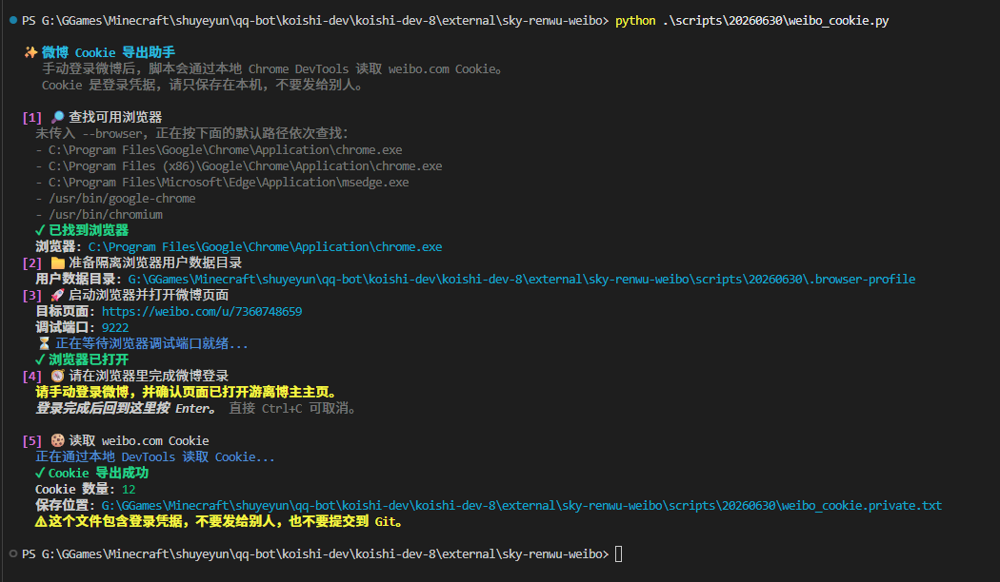
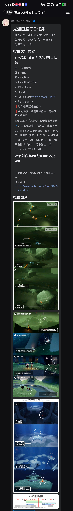

# koishi-plugin-sky-renwu-weibo

[](https://www.npmjs.com/package/koishi-plugin-sky-renwu-weibo)
[](https://npm-stat.com/charts.html?package=koishi-plugin-sky-renwu-weibo)

[](https://github.com/VincentZyuApps/koishi-plugin-sky-renwu-weibo)
[](https://gitee.com/vincent-zyu/koishi-plugin-sky-renwu-weibo)

[](https://forum.koishi.xyz/t/topic/12627)
[](https://qm.qq.com/q/rvrRosfKMw)
[](https://qm.qq.com/q/oVxZoksppK)

<h2>💬 交流反馈</h2>
<p>🐛 Bug 反馈 / 💡 建议 / 👨‍💻 插件开发交流，欢迎加群：</p>
<p><del>💬 插件使用问题 / 🐛 Bug反馈 / 👨‍💻 插件开发交流，欢迎加入QQ群：<b>259248174</b>   🎉（这个群G了）</del></p> 
<p>💬 插件使用问题 / 🐛 Bug反馈 / 👨‍💻 插件开发交流，欢迎加入 awa群-zyu建的qq群：<b style="color: #12B7F5;">1085190201</b> 🎉</p>
<p>🤖 光遇 Bot / QQ 官方 Bot / Koishi 相关交流，也欢迎加入光遇 Bot QQ 群：<b style="color: #EA5252;">475328908</b></p>
<p>💡 在群里直接艾特我，回复的更快哦~ ✨</p>

📅✅ 获取微博博主 [`@今天游离翻车了吗`](https://weibo.com/u/7360748659) 的光遇国服每日任务，支持文字、图片、Puppeteer 卡片图和 QQ Markdown ✨

> [!IMPORTANT]
>
> 🙏 特别感谢微博博主 **[`@今天游离翻车了吗`](https://weibo.com/u/7360748659)** 多年来稳定更新光遇每日任务内容。
>
> 这个插件只是做自动化获取和转发，真正持续维护每日攻略内容的是博主本人。

> [!IMPORTANT]
>
> 🙏 特别感谢 [github.com/Kaguya233qwq/nonebot_plugin_sky](https://github.com/Kaguya233qwq/nonebot_plugin_sky) 仓库提供的微博爬虫思路参考。
>
> 本插件在 TypeScript + Koishi 环境中重新实现相关流程。

> [!TIP]
>
> `puppeteer`、`assets` 和 `server` 都是**可选服务**，不启用对应功能时不需要安装。
>
> - 启用 `puppeteer-image` 卡片图发送形式时，需要启用 Koishi 的 `puppeteer` 服务。
> - 启用 `append-puppeteer-image` QQ Markdown 按钮行为时，会根据配置模式使用 Koishi 的 `assets` 或 `server` 服务，把 Puppeteer 卡片图转换成 QQ 官方 Bot 可访问的公网图片 URL。
> - `standalone` 和 `append-qq-markdown` 不使用 `assets` / `server` 图片 URL 生成功能，也不依赖它们。
> - `qqMarkdownButtonMode` 只对 QQ 官方 Bot 群聊生效，不影响 QQ 私信和其他平台的任何行为。

## 📌 指令

```text
今日光遇国服任务
```

命令名称可以在配置项 `commandName` 中修改。

可以用命令选项临时覆盖微博访问策略，优先级为：`--weibo` 命令选项 > `weiboAccessMode` 配置项。`mode` 不区分大小写，可用值为：

```text
cookie-only
guest-only
cookie-then-guest
guest-then-cookie
```

示例：

```text
今日光遇国服任务 --weibo guest-only
今日光遇国服任务 --weibo COOKIE-ONLY
```

## 🔐 微博访问策略与 Cookie

推荐保持默认访问策略 D：先尝试移动端无登录用户态，失败或未匹配到今日任务时再 fallback 到 PC 微博网页登录态。

默认情况下可以先不填写 `weiboCookie`。如果移动端公开接口受限、无登录用户态没有匹配到今日任务，或想提高兜底稳定性，再运行仓库内的辅助脚本打开有头浏览器，手动登录微博后导出 `weibo.com` Cookie，并填入插件配置项 `weiboCookie`。

> [!IMPORTANT]
>
> Cookie 辅助脚本只使用 Python 标准库，不需要安装任何第三方库，也不需要 `pip install`。
>
> 建议使用 Python `3.10` - `3.13`，优先推荐和作者同款的 Python `3.13`。脚本使用了 Python 3.10+ 的类型标注语法，Python 3.9 及以下不建议使用。

> [!TIP]
>
> 这个脚本底层使用的是 **CDP（Chrome DevTools Protocol）**，不是 Selenium。
>
> 它会启动带 `--remote-debugging-port` 的 Chrome / Edge，只访问本机 `127.0.0.1` 的 DevTools 调试端口，再通过 CDP 的 `Network.getAllCookies` 读取当前 PC 微博网页登录态下的 `weibo.com` Cookie。
>
> 脚本不会把完整 Cookie 打印到终端或写进调试日志，只会把结果写入本地 `weibo_cookie.private.txt`。

由于安全原因，插件不会内置任何微博登录 Cookie，也不建议把 Cookie 写进源码、README、issue 或聊天记录中。请自行登录微博并获取自己的 Cookie。

当前推荐配置流程是：先保持默认 D 使用移动端无登录用户态；需要 Cookie fallback 时，再通过 Python 脚本使用 CDP 获取本机 PC 浏览器里的 `weibo.com` 登录态，并把导出的 Cookie 复制到 Koishi 配置项 `weiboCookie`。

由于浏览器安全策略和跨域限制，Koishi Console 页面暂时无法直接读取 `weibo.com` 的登录 Cookie，因此获取 Cookie 的流程目前没有内置到浏览器 WebUI 中。插件运行时也不会自动读取本地 `weibo_cookie.private.txt`，这个文件只用于把内容复制到配置项。

脚本说明见：[scripts/readme.md](./scripts/readme.md)

脚本会优先使用 `--browser` 传入的浏览器路径；如果没有传入，会依次尝试寻找下面这些默认路径：

```text
C:\Program Files\Google\Chrome\Application\chrome.exe
C:\Program Files (x86)\Google\Chrome\Application\chrome.exe
C:\Program Files\Microsoft\Edge\Application\msedge.exe
/usr/bin/google-chrome
/usr/bin/chromium
```

你也可以使用 `--browser` 参数指定浏览器路径。

```bash
# 🪟 on Windows：使用默认路径自动查找
python scripts\20260630\weibo_cookie.py
# 🪟 on Windows：也可以使用 --browser 指定浏览器路径
python scripts\20260630\weibo_cookie.py --browser "C:\Program Files\Google\Chrome\Application\chrome.exe"
# 🐧 on Linux：使用默认路径自动查找
python scripts/20260630/weibo_cookie.py
# 🐧 on Linux：也可以使用 --browser 指定浏览器路径
python scripts/20260630/weibo_cookie.py --browser "/usr/bin/google-chrome"
```

运行后目录大致如下：

```text
scripts/
└── 20260630/
    ├── weibo_cookie.py             # 🌐 打开有头浏览器，登录微博并导出 Cookie
    ├── latest.debug.log            # 🧾 调试日志，包含本地运行信息
    ├── weibo_cookie.private.txt    # 🔐 访问策略 A/C/D 可使用的 weiboCookie
    └── .browser-profile/           # 🗂️ 隔离浏览器用户数据目录，可能包含登录态
```

把 `weibo_cookie.private.txt` 的内容填入 Koishi 插件配置项 `weiboCookie`。访问策略 A/C/D 会使用这个配置项，策略 B 不使用它；插件不会自动读取本地 txt 文件。

`weibo_cookie.private.txt`、`latest.debug.log` 和 `.browser-profile` 都包含隐私信息，不要发给别人，也不要提交到 Git。



## 💬 被动指令输出方式

插件配置项 `msgFormArr` 是表格形式：每一行选择一种发送形式，并通过 `enabled` 控制是否启用。可以调整行顺序，插件会按表格顺序发送；`strictOrderMode=false` 时会并行发送，发送顺序不保证。

每种已启用发送形式都会在内容最前加入 `dailyTaskGeneralIntroHint`，再加入被动指令提示 `dailyTaskPassiveIntroHint`。两个配置都可留空；相同发送形式可以重复添加，表格中的每个启用条目都会独立发送一次。

- 📄➕🖼️ `text-with-image`：先文后图，一条消息内先发送微博长文本，再发送全部图片
- 🖼️➕📄 `image-with-text`：先图后文，一条消息内先发送全部图片，再发送微博长文本
- 📄 `text`：纯文字，只发送微博长文本、数据来源和原文链接
- 📦 `forward`：图文合并转发，把文字和图片打包进合并转发；是否限制平台由 `restrictForwardPlatforms` 和 `forwardSupportedPlatforms` 决定
- 🖼️ `puppeteer-image`：Puppeteer 卡片图，把文字和微博图片排版成一张圆角卡片图
- 🤖 `qq-markdown`：QQ 官方 Bot Markdown 正文消息，只有 QQ 官方 Bot 平台能用；操作按钮行为由 `qqMarkdownButtonMode` 控制，但 `qqMarkdownButtonMode` 只对 QQ 官方 Bot 群聊生效，不影响 QQ 私信和其他平台的任何行为

默认启用 `forward`、`puppeteer-image` 和 `qq-markdown`。

默认开启 `restrictForwardPlatforms`，因此 `forward` 仅向 `forwardSupportedPlatforms` 中的平台发送，默认值为 `onebot`、`red`、`discord`。关闭开关后，所有平台都会尝试发送，由适配器决定是否支持；开关开启但列表为空时，所有平台都会跳过 `forward`。`puppeteer-image` 模式需要启用 Koishi 的 `puppeteer` 服务；未启用时插件会跳过该发送形式。`append-puppeteer-image` 按钮行为还需要根据配置模式启用 Koishi `assets` 或 `server` 服务，用于生成公网 `http(s)` 图片地址。`standalone` 和 `append-qq-markdown` 不使用这套图片 URL 生成逻辑。

QQ 官方 Bot 平台使用 `puppeteer-image` 或 `append-puppeteer-image` 时，建议把 Puppeteer 卡片图输出格式改为 `jpeg` 或 `webp`，并适当调低 `screenshotQuality`。如果继续使用默认 PNG，微博图片较多时生成的长图可能过大，导致 QQ 平台不接受或不渲染图片。

## 📣 主动消息推送

主动推送不需要用户发送指令。插件会在 `activePushCron` 命中时抓取当天任务，并向 `activePushTargets` 中所有启用目标发送。每轮只抓取一次数据，再按目标与 Bot 分发；一个目标失败不会阻塞其他目标。

默认 Cron 为 `0 1,7,13,19 * * *`，表示每天 01:00、07:00、13:00、19:00 触发。时间由 `activePushTimezoneGmtOffset` 的 GMT 偏移解释，默认 `8` 即 GMT+8；只支持整数偏移，不处理夏令时。

主动推送默认关闭，目标列表默认空。`activePushUseCache=false` 时，每次定时或手动测试都绕过 `cacheMinutes` 重新请求微博；开启后才会复用现有缓存。

Cron、Console 立即推送和管理员测试指令都属于主动场景。每种已启用发送形式会在内容最前加入 `dailyTaskGeneralIntroHint`，再加入 `dailyTaskActiveIntroHint`；独立 QQ JSON 按钮保持原有内容且只发送一次，不包含这些提示。

### 🎯 目标填写

`activePushTargets` 是 WebUI 表格，每行包含备注、platform、Bot selfId、Channel ID 和启用开关。

| 平台 | Channel ID | selfId 留空 |
|---|---|---|
| `qq` | QQ 官方 Bot 群 `openid` | 向全部 QQ 官方 Bot 发送 |
| `onebot` | 真实 QQ 群号，或 `private:QQ号` | 向全部 OneBot 发送 |
| `qqguild` / `discord` 等 | 真实频道 ID | 向该平台全部已连接 Bot 发送 |

填写 `selfId` 时会精确匹配对应 Bot；留空则按设计向该平台所有已连接 Bot 发送，可能产生多条消息。`qq-markdown` 与 QQ JSON 按钮只会在 `platform=qq` 的官方群聊目标生效；其他发送形式继续复用 `msgFormArr`。

### 🧪 Console 手动测试

`enableConsoleWebuiTestArea` 默认开启，Koishi Console 的插件详情顶部会出现“主动消息推送测试”区域；不需要时可在插件配置中关闭。该区域仅允许 authority 3 的管理员访问，点击“立即推送”会先二次确认，再使用当前生效的目标、发送形式和缓存配置发送一次。

手动测试不受 `enableActivePush` 限制，便于在开启定时任务前验证 QQ 官方 Bot、频道 ID 与图片/Markdown 配置。Cron 抓取失败始终写入控制台；当 `verboseSessionLog=true` 时，失败说明还会发送到全部启用目标。

### 💬 管理员测试指令

`enableActivePushTestCommand` 默认关闭。开启后，authority 3 的管理员可执行 `${commandName}.主动推送测试`，向已保存的 `activePushTargets` 中全部启用目标发送一次每日任务；它不依赖 `enableActivePush`。

无论 `verboseSessionLog` 与 `verboseConsoleLog` 是否开启，命令调用者和 Console 都会收到简要结果。开启 `verboseSessionLog` 时，调用者会额外收到逐目标详情；开启 `verboseConsoleLog` 时，Console 会额外记录逐目标、缓存和发送形式详情。

### 🖼️ 效果预览




## 🔧 配置项

### 📌 指令配置

| 配置项 | 类型 | 默认值 | 说明 |
|---|---|---|---|
| `commandName` | `string` | `"今日光遇国服任务"` | 触发命令名称 |
| `commandAliases` | `string[]` | 现有 6 个别名 | 指令别名列表；每行一个，空白项跳过，清空列表则不注册额外别名 |

### 🔑 微博请求配置

| 配置项 | 类型 | 默认值 | 说明 |
|---|---|---|---|
| `uid` | `string` | `"7360748659"` | 微博用户 UID，默认是 [`@今天游离翻车了吗`](https://weibo.com/u/7360748659) |
| `authorName` | `string` | `"今天游离翻车了吗"` | 来源作者显示名，会展示在数据来源署名里 |
| `weiboAccessMode` | `"cookie-only" \| "guest-only" \| "cookie-then-guest" \| "guest-then-cookie"` | `"guest-then-cookie"` | 微博访问策略：A 仅 PC 微博网页登录态、B 仅无登录用户态、C 先 PC 网页登录态后无登录、D 先无登录后 PC 网页登录态；命令选项 `--weibo <mode>` 可临时覆盖此配置，优先级更高 |
| `weiboCookie` | `string` | `""` | PC 微博网页登录 Cookie；访问策略 A/C/D 会使用这个配置项，可用 `scripts/20260630/weibo_cookie.py` 导出后手动复制，不会自动读取本地 txt |
| `matchPattern` | `string` | 默认正则 | 筛选每日任务微博的正则表达式，微博文案格式变化时可调整 |
| `dailyTaskMatchStrictness` | `"strict" \| "standard" \| "lenient" \| "loose"` | `"lenient"` | 今日任务微博的匹配严格度；在「宁可漏也不误判」与「宁可误判也不漏」之间权衡 |
| `cacheMinutes` | `number` | `600` | 内存缓存分钟数；`0` 表示不缓存。默认 600（10 小时），因光遇每日任务同一天内不变 |
| `discardCacheAcrossBeijingMidnight` | `boolean` | `true` | 是否在跨越「每日刷新分界点」后强制丢弃缓存；即使 `cacheMinutes` 未到期，跨天也会重新请求 |
| `cacheMidnightOffsetMinutes` | `number` | `67` | 「每日刷新分界点」相对北京时间 0 点的偏移分钟数；默认 67 即凌晨 1:07，用于避开博主 0 点后才发博的空窗期。仅在上面开关开启时生效 |
| `requestTimeout` | `number` | `10000` | 微博请求超时时间，单位毫秒 |
| `userAgent` | `string` | Edge/Chrome UA | 请求微博使用的 User-Agent，通常保持默认即可 |

> **🧊 缓存与「光遇日」判定：** 光遇任务北京时间凌晨固定刷新，同一天内不变，所以缓存放长到 10 小时。跨过「刷新分界点」（默认凌晨 1:07）后即便缓存没到期也强制刷新。分界点从 0 点后移 67 分钟，是因为博主发当天任务微博通常晚于 0 点，避开 0:00 到发博之间的空窗期。
>
> **🚫 绝不发昨天的任务：** 插件**优先按微博正文里的「X月X日任务」日期**判断任务归属哪天（抠不到日期才退回按发布时间兜底）。只要正文日期不是今天，就明确返回「今天还没发送任务微博」的提示，不会把昨天的任务当今天发。
>
> **🎯 匹配严格度 `dailyTaskMatchStrictness`：** 判断依据三个信号——A 命中 `matchPattern` 正则、B 正文日期是今天、C 发布时间是今天。
>
> | 档位 | 判定条件 | 取舍 |
> |---|---|---|
> | 🔒 `strict` | A **且** (B 或 C) | 防一切误判，博主改格式会漏 |
> | ⚖️ `standard` | A **或** B | 接近插件最初逻辑 |
> | 🍃 `lenient`（默认） | 有正文日期就只看 B；无日期退回 A 且 C | 防漏优先，改格式也能扛 |
> | 🌊 `loose` | A 或 B 或 C 任一 | 几乎不漏，误判概率最高 |
>
> 默认 `lenient` 的理由：漏任务群友看不到，比偶尔误判更影响体验；而误判要求闲聊里恰好出现「今天日期+任务」字样，概率极低。无论哪档，正文日期能抠出且非今天都不会命中，不会误发昨天任务。

### 🖼️ 微博图片下载配置

| 配置项 | 类型 | 默认值 | 说明 |
|---|---|---|---|
| `imageDownloadConcurrency` | `number` | `2` | 图片下载并发数；降低并发可以缓解微博图片同时请求过多导致的失败 |
| `imageDownloadTimeout` | `number` | `20000` | 单张图片下载超时时间，单位毫秒 |
| `imageDownloadRetryCount` | `number` | `2` | 单张图片失败后的额外重试次数；默认最多尝试 3 次 |
| `imageDownloadRetryDelay` | `number` | `1000` | 重试初始等待时间，单位毫秒；后续按指数退避增加 |
| `imageDownloadMaxWait` | `number` | `120000` | 图片下载阶段最长等待时间，单位毫秒；到时后未完成图片会记录为失败 |
| `imageCdnRotateStrategy` | `"off" \| "on-final-retry" \| "each-retry" \| "parallel-race"` | `"each-retry"` | 下载重试时的 CDN 域名轮换策略；换域名不损画质，专治个别节点抽风超时 |
| `imageSizeDegradeStrategy` | `"always-largest" \| "degrade-final-retry" \| "degrade-each-retry" \| "start-mid"` | `"degrade-final-retry"` | 下载重试时的尺寸降级策略；降级会损失画质，作为拿不到高清图的兜底 |
| `incompleteImageBehavior` | `"send-available" \| "text-only" \| "skip"` | `"send-available"` | 图片不完整时的策略：发送成功子集、强制只发一条文字任务，或只发状态说明且不发送任务内容 |

所有发送形式都只使用成功下载的同一批图片，并展示成功数/总数；图片顺序仍按原微博顺序保留。图片不完整的结果仍按 `cacheMinutes` 正常缓存，同时发起的同一微博请求会合并为一次下载。

> **🌐 CDN 域名轮换 × 📐 尺寸降级 策略矩阵**（两者各自独立推进、互不干扰）：
>
> | 档位 | `imageCdnRotateStrategy`（换域名，不损画质） | `imageSizeDegradeStrategy`（降尺寸，损画质） |
> |---|---|---|
> | 🔒/💎 关闭·最高清 | `off`：始终原始链接，不换域名 | `always-largest`：永远最大尺寸，拿不到就缺图 |
> | 🐢 保守 | `on-final-retry`：仅最后一次重试换一个域名 | `degrade-final-retry`：仅最后一次重试降一档（**默认**） |
> | ⚖️ 均衡 | `each-retry`：每次重试轮换域名 wx2→wx3→wx4→wx1（**默认**） | `degrade-each-retry`：每次重试降一档 large→mw2000→mw1024→mw690 |
> | 🚀 激进 | `parallel-race`：首次并发多域名抢答 ⚠️ 请求翻倍，可能触发限流/反爬 | `start-mid`：首次就从中等尺寸 mw2000 起步 |
>
> **💡 实现细节与坑：** 两个策略都是**纯 URL 字符串替换**——域名只认 `xxx{数字}.sinaimg.cn` 这类 host，尺寸只认路径里的 `large`/`mw2000` 等标识，**格式不认识时都原样退回原链接**，不会瞎改。默认组合是「换域名积极（纯赚）、降尺寸克制（保画质）」。想看高清大图可直接点开消息里的微博原文链接，所以尺寸降级不必太在意画质损失。`parallel-race` 请求量成倍增加，谨慎开启。

### 💬 消息发送形式配置

| 配置项 | 类型 | 默认值 | 说明 |
|---|---|---|---|
| `enableQuote` | `boolean` | `true` | bot 发送普通消息时是否引用触发指令；`forward` 合并转发模式不会附带引用 |
| `enableWaitingHint` | `boolean` | `true` | 是否显示“获取并生成中.... 请耐心等待”等待提示；所有发送形式完成后会尝试撤回 |
| `dailyTaskGeneralIntroHint` | `string` | `"给主人送上今日光遇国服任务喵"` + 原每日任务提醒 | 每种已启用发送形式最前的通用文字提示；默认值保留原有提醒，留空时跳过 |
| `dailyTaskPassiveIntroHint` | `string` | `"主人这么厉害 还记得手动指令查询 每日任务 喵"` | 普通用户查询指令时接在通用提示后的文字；留空时跳过 |
| `dailyTaskActiveIntroHint` | `string` | `"按照主人定时计划按时给主人送上今日 每日任务喵"` | Cron、Console 与管理员测试指令接在通用提示后的文字；留空时跳过 |
| `msgFormArr` | `{ mode, enabled }[]` | 见说明 | 每日任务发送形式表格，可调整顺序、启用 / 禁用，也可重复添加相同模式；默认启用 `forward`、`puppeteer-image` 和 `qq-markdown` |
| `restrictForwardPlatforms` | `boolean` | `true` | 是否按下方列表限制 `forward`；关闭时所有平台都会尝试发送 |
| `forwardSupportedPlatforms` | `string[]` | `["onebot", "red", "discord"]` | `forward` 允许的平台列表；仅在限制开启时生效，空列表表示不向任何平台发送 `forward` |
| `strictOrderMode` | `boolean` | `true` | 是否严格按照表格顺序串行发送；关闭后会并行发送，顺序不保证 |

### 📣 主动消息推送

| 配置项 | 类型 | 默认值 | 说明 |
|---|---|---|---|
| `enableActivePush` | `boolean` | `false` | 是否启动 Cron 定时推送；不影响 Console 手动测试 |
| `activePushCron` | `string` | `"0 1,7,13,19 * * *"` | 5 段 Cron 表达式，默认每天 01:00、07:00、13:00、19:00 |
| `activePushTimezoneGmtOffset` | `number` | `8` | Cron 使用的整数 GMT 偏移，`8` 表示 GMT+8；范围 -12 至 14，不处理夏令时 |
| `activePushUseCache` | `boolean` | `false` | 是否按 `cacheMinutes` 使用微博缓存；关闭时每次主动推送强制刷新 |
| `activePushTargets` | `ActivePushTarget[]` | `dev` OneBot 目标 | 主动推送目标表；包含 `note`、`platform`、`selfId`、`channelId`、`enabled` |
| `enableActivePushTestCommand` | `boolean` | `false` | 是否注册 `${commandName}.主动推送测试`；仅 authority 3 可执行，不依赖 Cron 总开关 |
| `enableConsoleWebuiTestArea` | `boolean` | `true` | 是否注册 Console 插件详情中的管理员主动推送测试区域 |

### 🤖 QQ 官方 Bot Markdown 适配

| 配置项 | 类型 | 默认值 | 说明 |
|---|---|---|---|
| `qqMarkdownPuppeteerImageStorageMode` | `"assets" \| "server"` | `"server"` | append-puppeteer-image 的图片 URL 生成模式；仅在按钮行为勾选 `append-puppeteer-image` 且消息发送形式启用 `puppeteer-image` 时生效；`assets` 模式只能新增、不能删除、命名不可控，`server` 模式使用 `ctx.baseDir/cache/sky-renwu-weibo`，支持时间命名，并按数量上限仅保留最新图片 |
| `qqMarkdownPuppeteerImageSelfUrl` | `string` | `""` | server 模式公网 URL 覆盖值；仅在 `append-puppeteer-image` 且存储模式为 `server` 时生效；留空则回退 `ctx.server.config.selfUrl` |
| `qqMarkdownPuppeteerImageMaxFiles` | `number` | `5` | server 模式缓存图片数量上限；仅在 `append-puppeteer-image` 且存储模式为 `server` 时生效；仅保留最新 N 张，填写 `<= 0` 表示不设置上限 |
| `qqMarkdownMode` | `"structured" \| "blockquote"` | `"structured"` | QQ Markdown 文案整理模式；`structured` 会尝试按正则整理标题、任务条目和来源，`blockquote` 会把全文逐行放进引用块 |
| `qqMarkdownButtonMode` | `string[]` | `["append-qq-markdown", "append-puppeteer-image"]` | QQ Markdown 按钮发送行为，可多选；只对 QQ 官方 Bot 群聊生效，不影响 QQ 私信和其他平台的任何行为；`standalone` 单独发送固定的 `## 光遇任务操作按钮` 消息并附带按钮，`append-qq-markdown` 在启用 `qq-markdown` 发送形式时把按钮挂到正文 Markdown 后面，`append-puppeteer-image` 在启用 `puppeteer-image` 发送形式时按上方模式把 Puppeteer 卡片图转成公网 URL 后发送 Markdown 图片并附带按钮 |
| `qqMarkdownKeyboardJson` | `string` | [默认按钮 JSON](./src/qq/keyboard.ts) | QQ Markdown 按钮 JSON 配置；只在 `qqMarkdownButtonMode` 生效时使用；`qqMarkdownButtonMode` 只对 QQ 官方 Bot 群聊生效，不影响 QQ 私信和其他平台的任何行为；默认两行三个按钮：第一行 `🔄 再次获取` 执行 `${commandName}`、`❓ 获取帮助` 执行 `${commandName} --help`，第二行 `🎲 玩玩别的` 执行 `help` |

> [!IMPORTANT]
>
> `qqMarkdownButtonMode` 只对 QQ 官方 Bot 群聊生效，不影响 QQ 私信和其他平台的任何行为。
>
> QQ 官方 Bot 群聊和私信可以通过会话字段区分：
>
> ```text
> QQ 群聊：platform = qq，guildId 非空，channelId 不以 private: 开头
> QQ 私信：platform = qq，guildId 为空，channelId 通常形如 private:用户ID
> ```
>
> 因此 QQ 私信和其他平台会忽略所有 JSON 按钮行为，继续按各自原有发送方式处理。

在 QQ 官方 Bot 群聊中，`append-qq-markdown` 必须同时启用 `qq-markdown`。`append-puppeteer-image` 必须同时启用 `puppeteer-image`，并根据配置模式依赖 Koishi `assets` 或 `server` 服务提供公网 `http(s)` 图片地址。如果条件不满足，会话里默认静默跳过；只有开启 `verboseSessionLog` 时才会额外发送会话提醒。QQ 私信和其他平台不会检查这些按钮行为条件，也不会因为 `qqMarkdownButtonMode` 改变原有发送行为。`standalone` 不使用 `assets` / `server` 图片 URL 生成功能。

`server` 模式会把临时图片写到 `ctx.baseDir/cache/sky-renwu-weibo`，文件名格式为 `yyyyMMdd-HHmmss.<ext>`，并按配置的数量上限只保留最新图片；`qqMarkdownPuppeteerImageMaxFiles <= 0` 表示不设置上限。超过上限时，较早生成的旧图片会被清理，旧 QQ Markdown 消息里的图片后续可能失效，这是预期行为。

### 🖼️ Puppeteer 卡片图配置

| 配置项 | 类型 | 默认值 | 说明 |
|---|---|---|---|
| `imageType` | `"png" \| "jpeg" \| "webp"` | `"png"` | Puppeteer 卡片图输出格式；PNG 不支持质量参数；QQ 平台建议改为 `jpeg` 或 `webp`，避免长图文件过大 |
| `screenshotQuality` | `number` | `88` | Puppeteer 卡片图截图质量，仅 JPEG / WEBP 生效；QQ 平台建议适当调低，图片过大可能不被接受 |
| `imageWidth` | `number` | `980` | Puppeteer 卡片图宽度，单位 px |
| `useCustomFont` | `boolean` | `true` | 是否使用自定义字体路径；关闭后使用系统默认字体，并跳过默认字体下载 |
| `autoDownloadFont` | `boolean` | `true` | 是否自动下载并校验默认字体 |
| `imageFontPath` | `string` | `process.cwd()/data/fonts/LXGWWenKaiMono-Regular.ttf` | Puppeteer 卡片图字体路径；运行时自动映射到 `ctx.baseDir/data/fonts/LXGWWenKaiMono-Regular.ttf` |

Puppeteer 卡片图默认使用 `LXGWWenKaiMono-Regular.ttf`。插件加载时会检查 `ctx.baseDir/data/fonts/LXGWWenKaiMono-Regular.ttf`。字体存在且 hash 校验通过时会跳过下载；缺失或校验失败时会尝试从 Gitee / GitHub 下载。配置项 `useCustomFont=false` 或 `imageFontPath` 为空时会使用系统默认字体。

### 🐛 调试配置

| 配置项 | 类型 | 默认值 | 说明 |
|---|---|---|---|
| `verboseSessionLog` | `boolean` | `false` | 是否在会话中输出详细调试信息；关闭时 QQ Markdown 按钮跳过提醒默认不会发送到会话，开启后才会同步发送到会话 |
| `verboseConsoleLog` | `boolean` | `false` | 是否在控制台输出详细调试信息；关闭时非 QQ 平台的 QQ Markdown 按钮跳过提醒不会输出到控制台，开启后会输出缓存、微博访问策略、游客态 Cookie 初始化、微博接口状态码、列表数量、匹配样本、渲染、发送、assets/server 图片 URL 生成和字体检查细节 |
